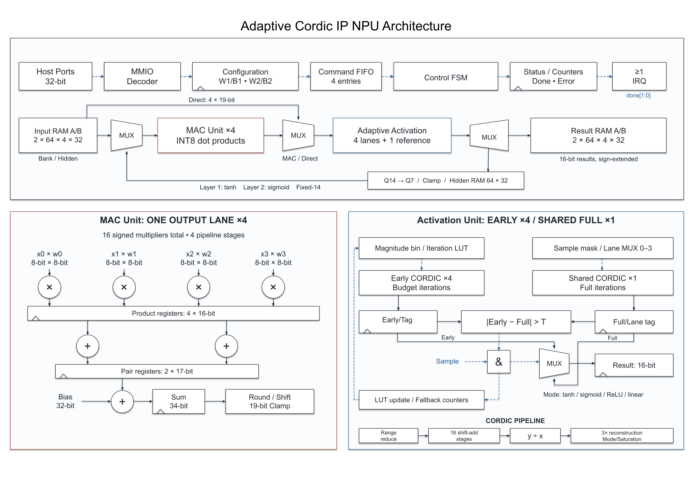

# CORDIC NPU

Fixed-point tanh/sigmoid activation hardware with adaptive iteration control, a systolic MAC, and FPGA integration.

- `Phase1_Bitmodel/`: Python model, CORDIC notebook, and test vectors.
- `Phase2_RTL/rtl/`: accelerator RTL; `sources.f` lists the sources.
- `Phase2_RTL/verification/`, `asic/`, `uvm_tb/`, `spi_tb/`: verification flows.
- `Phase2_RTL/fpga/`: firmware, build scripts, simulations, and PYNQ notebooks.
- `Phase2_RTL/evaluation/`: evaluation scripts, model/test data, and saved results.
- `arch.pptx`: architecture slides.

## System Architecture



## Python

From the project root, install NumPy and run the frozen banknote model:

```powershell
python -m pip install numpy
python "Phase1_Bitmodel/model.py" 3.6216 8.6661 -2.8073 -0.44699
```

On Linux, use `python3` if `python` is unavailable. Open `Phase1_Bitmodel/cordic.ipynb` in Jupyter for the CORDIC model.

## Verilog / Cadence

Use Linux with licensed Cadence Xcelium. Load the lab's Cadence environment, then run:

```bash
cd Phase2_RTL
bash run.sh check
bash run.sh spi
bash run.sh uvm 1
bash run.sh wave
```

`check` validates Bash syntax and source paths without a simulator. `spi` runs SPI/accelerator tests. `uvm 1` runs the streaming UVM test with seed 1 and coverage. `wave` opens the accelerator in SimVision; press Run to simulate. For UVM waveforms, use `bash run.sh uvm 1 wave`.

From inside `Phase2_RTL/spi_tb`, use `bash run.sh xrun` or `bash run.sh wave 1 tb_accelerator`. From inside `Phase2_RTL/asic`, use `bash uvm.sh 1`. Each runner resolves paths from its own location. The folder name is `Phase2_RTL` (no spaces).

Logs: `Phase2_RTL/spi_tb/results/` and `Phase2_RTL/asic/reports/xcelium_seed_1/`. Batch runs require a `PASS` marker and no simulation errors. SimVision scratch/waveform locations are printed by the SPI runner; UVM waveforms stay beside its logs.

Scripts use Unix LF endings, enforced by `.gitattributes`. If an older server copy reports `invalid option namepipefail`, update the files or run `find . -type f \( -name '*.sh' -o -name '*.csh' \) -exec sed -i 's/\r$//' {} +` once. Do not paste the `Student@...` prompt or `?` continuation prompt into commands.

## ASIC flow

Scripts are in `Phase2_RTL/asic/flow/`. Load Cadence and Tcl (`tclsh`, or set `TCLSH`), then run from `Phase2_RTL`:

```bash
bash run.sh asic list
bash run.sh asic check
export ASIC_CONFIG=/absolute/path/site.tcl
bash run.sh asic check syn
bash run.sh asic syn
```

`site.tcl` overrides `cfg(...)` values in `asic/flow/config.tcl`; for example, `set cfg(lib_max) {/pdk/slow.lib}`. Use absolute paths and Tcl lists. Supply slow/fast Liberty libraries, technology/cell LEFs, both QRC corners/temperatures, Verilog cell models, row site, routing layers, PG/CTS cells, and GDS files/map. The 40 ns constraint is a starting budget; confirm library time/capacitance units.

Run stages individually in the order shown by `list`:

| Steps | Stage commands | Tool |
| --- | --- | --- |
| 1-4 | `spec`, `rtl`, `sim`, `lint` | Specification/source inventory, Xcelium, JasperGold |
| 5-7 | `syn`, `lec`, `pregls` | Genus, Conformal, Xcelium |
| 8-12 | `floor`, `power`, `place`, `cts`, `route` | Innovus |
| 13-15 | `pex`, `sta`, `postgls` | Quantus through Innovus, Tempus, Xcelium |
| 16-17 | `drc`, `arc`, `lvs` | PDK-qualified Pegasus/PVS commands |
| 18-19 | `eco`, `final_lec` | Innovus, Conformal |

Genus uses Common UI; Innovus/Tempus use classic Tcl commands. Adapt commands to the installed release. Detailed stages and block specification are in `asic/plan.json`. Outputs go to `asic/work/` (`ASIC_OUT` overrides this).

Required lab adapters are configured explicitly: `lint_hook` runs the licensed Jasper lint app using `rtl_sources`; `floor_hook` places pins, taps and endcaps; `finish_hook` performs idempotent filler, tie, antenna and metal-fill finishing; `sta_hook` applies approved OCV/SI/corner settings; `eco_hook` applies the reviewed ECO. Hooks execute in the tool and can access `cfg`, `out`, `rev_dir`, and `rtl_dir`.

`lint_check` checks the lint output directory. `lec_check` checks each Conformal log for complete equivalence, zero unresolved black boxes and no unproven/unmapped failures. Each is a Tcl command list returning nonzero on failures or missing/incomplete reports. DRC/ARC/LVS each require `<stage>_cmd` and `<stage>_check` command lists for the actual foundry runset and its report parser. They receive `ASIC_TOP`, `ASIC_GDS`, `ASIC_NETLIST` and `ASIC_REPORT`; the checker also receives the report filename. ARC means antenna-rule checking, after DRC. Innovus geometry/connectivity reports are preliminary checks, not foundry sign-off.

Pre-layout GLS uses the synthesis SDF; post-layout GLS runs minimum and maximum SDF corners with the existing UVM scoreboard. Inspect annotation coverage and timing violations. After `eco`, rerun `pex`, `sta`, `postgls`, `drc`, `arc`, `lvs` and `final_lec` with `ASIC_REV=eco` (for example, `ASIC_REV=eco bash run.sh asic pex`). Final LEC compares the implementation against the synthesized functional design.

These scripts have not been executed with your PDK or Cadence implementation tools. A completed tool process is not sign-off. This is a functional block flow; DFT/ATPG, pad-ring integration and EM/IR closure need separate work.

Command references: [Genus/Conformal handoff](https://community.cadence.com/cadence_technology_forums/f/logic-design/59112/conformal-cec-checking), [Quantus extraction setup](https://community.cadence.com/cadence_technology_forums/f/digital-implementation/33561/qrc-extraction-issue), [SDF corner export](https://community.cadence.com/cadence_technology_forums/f/digital-implementation/17972/write_sdf-in-mmmc-flow).
